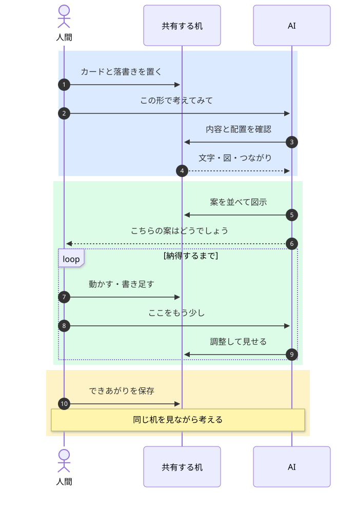

# Tabletop

**人間とAIの共有作業机。資料を広げ、並べ、つなぎながら、一緒に考えます。**

思いついたことをカードに書く。言葉にしにくい形は落書きする。関係するものを近くへ置き、線で結ぶ。

その机を見ながら、AIに頼めます。

**「このカードを、見やすく整理して」**

Tabletopは、人間がブラウザで操作する机を、AIもMCPを通じて読み取り、編集できるアプリです。会話は普段のAIのチャットで続けます。文章だけでなく、机に置いた内容や配置も、相談の手がかりになります。

## この紹介を、机で読む

**[READMEの机を開く](https://zuntan.github.io/tabletop/?desk=desks/README.tabletop)**

文章と図を机の上に広げた紹介です。ブラウザで眺めながら読めます。

## まず、机を触ってみる

**[チュートリアル机を開く](https://zuntan.github.io/tabletop/?desk=desks/tabletop-guide.tabletop)**

インストールなしで、道具の説明と実物サンプルをブラウザから試せます。緑の道しるべを選び、現れる ▶ を押してみてください。線に沿って机を移動し、説明とサンプルを行き来できます。

これはAIに接続しない静的ページ版です。自分の机をAIにつないだら、同じ道具を使って、会話しながら一緒に作業できます。

## 手で置いて、AIに頼んで、また手を加える

カード、画像、図形、Mermaid、リンク、手描きの落書きなどを、広い机の好きな場所へ置けます。クリップやクリアファイルでまとめ、定規に沿って並べたり、ハンコやシールで印を付けたりできます。

すべてを自分で操作してもよいですし、途中をAIに任せても構いません。

**「この文章を、意味ごとにカードへ分けて」**

AIが作ったカードを、自分で動かす。気になる箇所に印を付け、もう一度相談する。

**「この関係を図にして」**

並んだ案を眺めて、線を引いたり、落書きで「こんな感じ」を添えたりする。

**「選んだカードを、見やすく並べて」**

頼む範囲は、そのとき次第です。人間が全部を言葉に直すことも、AIが全部を決めることも前提にしていません。

図も、チュートリアル机のMermaidサンプルです。

## AIと自分の机を使い始める

通常版をPCへ配置し、使っているAIエージェントへTabletopのMCPを登録します。準備できたら、まずは一言。

**「Tabletopの机を開いてください」**

導入・MCP設定・初回接続・再接続は、**[INSTALL.md](INSTALL.md)** にまとめています。

作った机は.tabletopファイルで保存し、あとから続きを開けます。保存もAIに頼めます。

**「この机を保存して」**

PDFやPNGにして持ち出すこともできます。静的ページ版を使えば、作った机をURLで人に見てもらえます。そこではAIに接続せず、ブラウザで閲覧・基本編集ができます。

## 利用前に

Tabletopは試作段階のアプリです。**自動保存はありません。机を閉じたり再読み込みしたりする前に保存してください。**

開発者はCodex・Copilot・piで利用しています。ただし、動作確認に使用したモデルはいずれも **GPT-6.1-Sol** のみです。その他のエージェントやモデルでは動作確認していません。

AIによって判断・操作の進め方・結果は異なる可能性があり、同じ動作や結果を保証するものではありません。

## 必要なときに読む

- [ドキュメントの案内](docs/README.md)
- [机という考え方](docs/tabletop-philosophy.md)
- [基本操作と机の上の道具](docs/authoring.md)
- [図形・線・接続](docs/diagram.md)
- [AIと同じ机を使う](docs/ai-interface.md)
- [静的ページで使う・公開する](docs/pages.md)
- [チュートリアル机の案内](docs/tabletop/README.md)

## ライセンス

Tabletop本体は[MIT License](LICENSE)です。Copyright © 2026 zuntan。

同梱するライブラリ・素材には、それぞれのライセンスが適用されます。[第三者通知集](public/licenses/THIRD_PARTY_NOTICES.txt)を同梱しています。利用者が机へ持ち込んだ画像や資料の権利は、Tabletop本体のライセンスとは別に扱われます。
