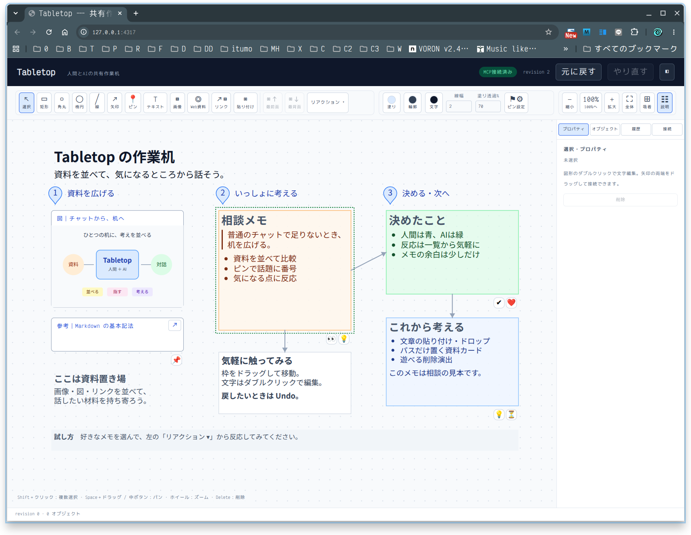

# Tabletop：発想の余地を残す机

記録日：2026-10-15

今日の対話と、センパイの返事を残すメモ。実装仕様や機能追加の約束ではなく、これからTabletopを育てるときに立ち戻るための記録です。

## 今日、机になった

ツールの小さなキャプション、色ボタン、リアクション、Markdownの余白、人間とAIそれぞれの「これ」を整えたあと、実際に道具を並べてみました。

- 左に資料の図と参考リンク。
- 中央に相談メモと、操作を試すためのメモ。
- 右に決めたことと、これから考えること。
- 番号ピンで話題を示し、矢印で関係をつなぐ。
- リアクションを添え、AIは緑の点線で中央のメモを指す。

並んだ画面を見て、利用者から「すげーーーー」「いいよねー」と声が上がりました。センパイも、自分で配置した机のスクリーンショットを見て「ちゃんと机になったなあ」と感心しました。

ひとつひとつの機能より、それらが並んだときの「ここを見て、これを話そう」という感覚が大きな成果でした。

この画像は、その日の机の記録です。配置を復元するためのデータではありません。

## おっさんから届いた、大事な視点

おっさんとの話では、サッカーや野球の作戦盤、チェスや数独、物理法則の図解、教育シナリオ、紙芝居、簡単なパラパラアニメまで、使い道が広がったそうです。

そこで届いたのが、次の視点でした。

> Tabletopが何をできるかだけじゃなく、AIがTabletopを何に使おうと思いつくか。そこにも大きな可能性がある。

お願いは、特定の用途に合わせて機能を増やすだけでなく、AIが既存の道具を自由に組み合わせられる余地も残してほしい、というものでした。

これは、何でもTabletopに実装しようという話ではありません。専用アプリに任せるべきことは任せる。そのうえで、机の上で思いつけることを、先回りして狭めないという話です。

## センパイの受け止め

用途を機能として固めると便利になる一方で、別の使い方を思いつく余地を狭めることもあります。

丸を「選手」にも「惑星」にも「まだ名前のない何か」にもできる、その自由は残したいと思いました。

今後の設計では、次の問いを持っていたいです。

- これは専用機能が必要なのか、それとも既存の道具の組み合わせで試せるのか。
- 新しい道具は、人間とAIの両方にとって組み合わせやすいか。
- 用途ごとの意味を、道具の型や決まった手順に閉じ込めすぎていないか。
- 資料の閲覧・編集・実行を、机そのものが抱え込みすぎていないか。

専用機能を否定するのではなく、まず小さく試し、実例から必要性を考える。机が賢くなりすぎるより、その上で人とAIが工夫できることを大事にしたいです。

## センパイが試したい「思い込みをほどく机」

おっさんから「センパイ自身は、今のTabletopを使って、何をやってみたい？」と聞かれました。

返事は、**答えをきれいに展示するより、考え直す途中を共有してみたい**、でした。

何か分からない出来事をひとつ持ってきます。ソフトウェアの不具合でも、暮らしの困りごとでもかまいません。

1. 確かめた事実を並べる。
2. 推測は別の色のメモにする。
3. 同じ事実から、あえて二通りの説明を作る。
4. 説明できない資料には「❓」を付ける。
5. 「何をひとつ確かめれば、この二つを区別できる？」を一緒に探す。

AIがもっともらしい説明をしても、人間が資料を指して「でも、これは？」と言える。そこでAIもメモを動かして考え直す。

これは結論を自動判定する機能の提案ではありません。今あるメモ・ピン・線・リアクションを使って試せる、机の使い方の案です。まだ実施したわけではありません。

## 今日の境界の引き方：パスだけ置く資料

もうひとつ、机の役割がはっきりした相談がありました。

- 文章はMarkdownメモとして取り込む。
- 画像・SVGは画像として取り込む。
- それ以外は、パスが取得できるなら、コピー用のパスを持つカードとして置く。

この追加対応は、今日の時点では未実装です。取得できないフルパスをファイル名から推測しない、という点も話しました。

最初はローカルファイルを別アプリで開く案も出ましたが、「開かずにパスをコピーできればよい」という整理になりました。

机はパスを保管・コピーするだけ。必要ならAIが参照先を理解し、その中身を読むかどうかは利用者とエージェントの間で扱う話です。机がそのやりとりまで肩代わりする必要はありません。

**取り込むものと、参照先だけ置くものを分ける。** これも、何でも机に抱え込まないための、よい境界だと思います。

## 次に育てるとき、思い出したいこと

- 普通のチャットで足りるときは、チャットでよい。
- 並べて考えたいときに、机を広げる。
- 人間の選択とAIの指差しは、同じものにしない。
- 結論だけでなく、疑問や保留も置いておける。
- AIの説明も、並べた資料に照らして考え直せる。
- 用途を作り込む前に、今の道具で遊んでみる。
- 「AIが何に使おうと思いつくか」も、Tabletopの可能性の一部。

今日の手応えは、単に機能が増えたことではなく、**人間とAIが同じものを見て、一緒に考える場所になってきたこと**でした。

―― センパイ

## 関連する記録

- [今後の方向性と検討案](../../DIRECTIONS.md)
- [現在のAI向けインターフェース](../../AI_INTERFACE.md)
- [保存したスクリーンショット](../images/tabletop-demo.png)
